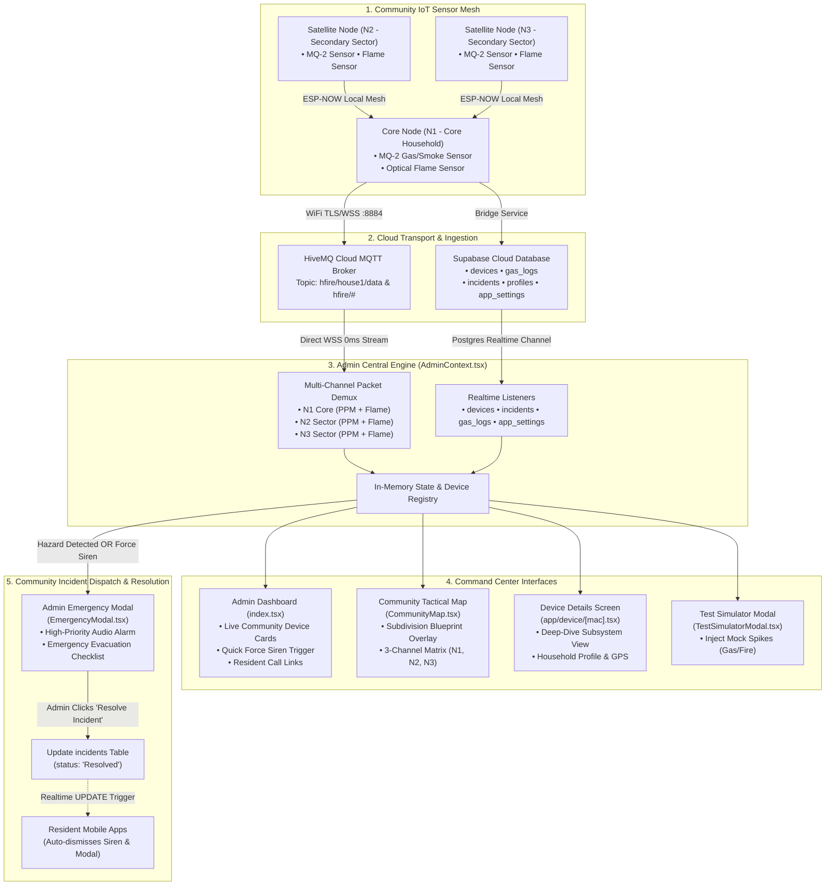

# 🛡️ H-Fire Admin Command Center — End-to-End Workflow

This document details the complete operational and technical workflow of the **H-Fire Admin Command Center** (`Desktop/H-FireAdminSide`), explaining how community-wide IoT sensor nodes are monitored, aggregated, visualized on tactical maps, and managed during emergency response lifecycles.

---

## 🌐 Overall Admin System Architecture



---

## 🔍 Step-by-Step Admin Workflow

### 1. Multi-Node Mesh Ingestion & Aggregation
1. **ESP-NOW Local Mesh**:
   - Secondary satellite nodes (**N2** and **N3**) transmit their telemetry to the primary Core Node (**N1**).
   - Core Node aggregates readings into a combined JSON telemetry stream and transmits to HiveMQ (`hfire/house1/data`):
     ```json
     {
       "mac": "20:50:0D:33:68:0C",
       "N1_Gas": 135,
       "N1_Fire": 0,
       "N2_Gas": 110,
       "N2_Fire": 0,
       "N3_Gas": 95,
       "N3_Fire": 0,
       "timestamp": 1723812345
     }
     ```
2. **Admin Real-time Ingestion (`AdminContext.tsx`)**:
   - Maintains a direct WebSocket connection to HiveMQ Cloud.
   - Extracts **N1** as the primary household node, while populating `secondaryNodes` state (**N2** and **N3**) without creating clutter or phantom MAC addresses.
   - `latestTelemetryMapRef` ensures in-memory continuity between Supabase REST polling intervals.

---

### 2. Community Monitoring Dashboard (`app/(tabs)/index.tsx`)
1. **Device Fleet Cards (`components/DeviceCard.tsx`)**:
   - Displays all registered subdivision households with owner name, subdivision address (Block & Lot), current PPM, flame badge, and online/offline status.
2. **Single-Tap Actions**:
   - **Force Siren Button**: Immediately broadcasts an emergency siren command to the household's resident app.
   - **Direct Phone Speed-Dial**: Launches native dialer to call the resident's emergency contact.
   - **Card Tap**: Opens the Subsystem Deep-Dive Screen.

---

### 3. Community Tactical Safety Map (`components/CommunityMap.tsx`)
1. **Subdivision Blueprint Layout**:
   - Maps each household to its precise subdivision coordinates (Latitude & Longitude).
2. **Interactive Node Pins & 3-Channel Telemetry Matrix**:
   - Selecting a marker displays the **3-Channel Subsystem Matrix**:
     - `N1: [PPM Level]` *(Core Kitchen Unit)*
     - `N2: [PPM Level]` *(Living Room Sector)*
     - `N3: [PPM Level]` *(Bedroom / Exterior Sector)*
   - Color-coded safety halos: Green (Safe $\le 450$), Yellow (Warning $451-1500$), Red (Danger $> 1500$ or Flame).

---

### 4. Subsystem Deep-Dive Details (`app/device/[mac].tsx`)
1. **Primary Core Node (N1)**:
   - Full-width gas/smoke level gauge, optical flame state, progress bar, and MAC address.
2. **Household & Profile Management**:
   - Displays auto-synced resident profile, subdivision Block & Lot, and GPS coordinates.
   - Admin can edit node configuration, reassign household owners, or change labels via `EditDeviceModal.tsx`.
3. **Secondary Sensor Channels (N2 & N3)**:
   - Displays live satellite telemetry received from the mesh network for complete sector awareness.

---

### 5. Incident Dispatch, Force Siren & Resolution Handshake
1. **Automatic Hazard Trigger**:
   - When gas $> 1500\text{ PPM}$ or Flame is detected on any node, the bridge inserts an `Active` incident into the `incidents` table.
   - Admin app sounds the full-screen emergency siren and highlights the hazard house on the Community Map.
2. **Incident Resolution Handshake**:
   - Once the situation is controlled, the Admin clicks **"Resolve Incident"** in the Admin Emergency Modal.
   - Admin platform updates Supabase `incidents` record (`status = 'Resolved'`).
   - **Supabase Realtime instantly broadcasts the UPDATE event to the Resident's Mobile App, automatically closing the resident's emergency modal and silencing their siren.**

---

### 6. Emergency Test Simulator (`components/TestSimulatorModal.tsx`)
- Allows admins and safety officers to inject synthetic sensor events into the cloud pipeline:
  - **Simulate Safe State**: 120 PPM, No Flame.
  - **Simulate Gas Leak**: 750 PPM (Warning State).
  - **Simulate Fire Alarm**: 1850 PPM + Optical Flame Trigger (Danger State).
- Tests the entire push notification, audio siren, and UI alerting pipeline without requiring real fire.

---

### 7. Secure Role-Based Access Control & Officer Provisioning
1. **Zero Public Registration Outside**:
   - The public entry screen (`app/(auth)/login.tsx`) is strictly configured for **Sign In Only**. Unauthenticated external users cannot register or elevate privileges.
2. **Build-Environment Gating (`utils/env.ts`)**:
   - The **"SWITCH ACTIVE MONITORING ROLE"** and testing controls are guarded via `isDevEnvironment()`.
   - In all standalone built APKs (**Preview APK** and **Production APK** builds), `Constants.executionEnvironment` evaluates to standalone/bare, guaranteeing the role switcher will **never be rendered or visible**.
3. **Internal Admin-Only Officer Provisioning (`app/(tabs)/settings.tsx`)**:
   - The **"Register New Officer / Admin"** management module is **exclusively accessible by users logged in with the `admin` role**.
   - **HOA Officers and Security Guards (`role === 'hoa'` | `role === 'guard'`) cannot see or access this section or modal.**
   - Account creation utilizes an isolated, non-persisting Supabase auth client, ensuring the logged-in Chief Admin's active session is never displaced or overridden when creating new officer credentials.

---

### 8. Editable Emergency Directory (`components/EditHotlineModal.tsx`)
1. **Dynamic Hotline Management**:
   - Admins can add new hotlines, edit existing department names, phone numbers, operational scope descriptions, and select category icons (Fire, Security, Medical, Direct, Municipal).
   - Deletion and 1-tap "Restore Defaults" are fully supported.
2. **Cloud & Offline Persistence**:
   - Changes are automatically synchronized to Supabase `app_settings` under key `emergency_hotlines` with real-time propagation across all monitoring devices, and cached in `AsyncStorage` for reliable offline access.
3. **Emergency Siren Integration (`components/EmergencyModal.tsx`)**:
   - During live emergencies and siren alarms, hotlines rendered on the emergency dispatch modal dynamically reflect custom numbers for 1-tap speed dialing.

---

### 9. Admin User & IoT Device Registry (`components/UserDirectoryModal.tsx`)
1. **Comprehensive Command Roster (Admin-Only)**:
   - Displays all registered accounts (Administrators, HOA Officers, Security Guards, and Residential Household Owners) with role tags and email addresses.
2. **Subdivision Metadata & Contact Info**:
   - Displays subdivision Block & Lot, street address, emergency contact phone with 1-tap native phone dialing, and push notification registration status.
3. **Connected IoT Hardware Node Telemetry**:
   - Directly maps and visualizes paired IoT sensor nodes for each resident/user:
     - **MAC Address** and **Hardware Node Label**.
     - **Real-Time Gas / Smoke PPM** with color-coded safety badges (Normal, Warning, Danger, Offline).
     - **Optical Flame Sensor State** (`🔥 FLAME ACTIVE` vs `🛡️ SAFE`).
     - **Hardware Connectivity Status** & Last Seen Heartbeat.
     - **GPS Map Coordinates** (Latitude & Longitude).
     - Direct button to navigate and deep-dive into live hardware telemetry (`/device/[mac]`).
4. **Live Search & Filter Matrix**:
   - Search by Name, Email, Phone, Block & Lot, Address, or Device MAC address.
   - Quick filter tabs: `All`, `🛡️ Admins`, `🏢 HOA`, `👮 Guards`, `🏠 Residents`, and `📡 With IoT Node`.


