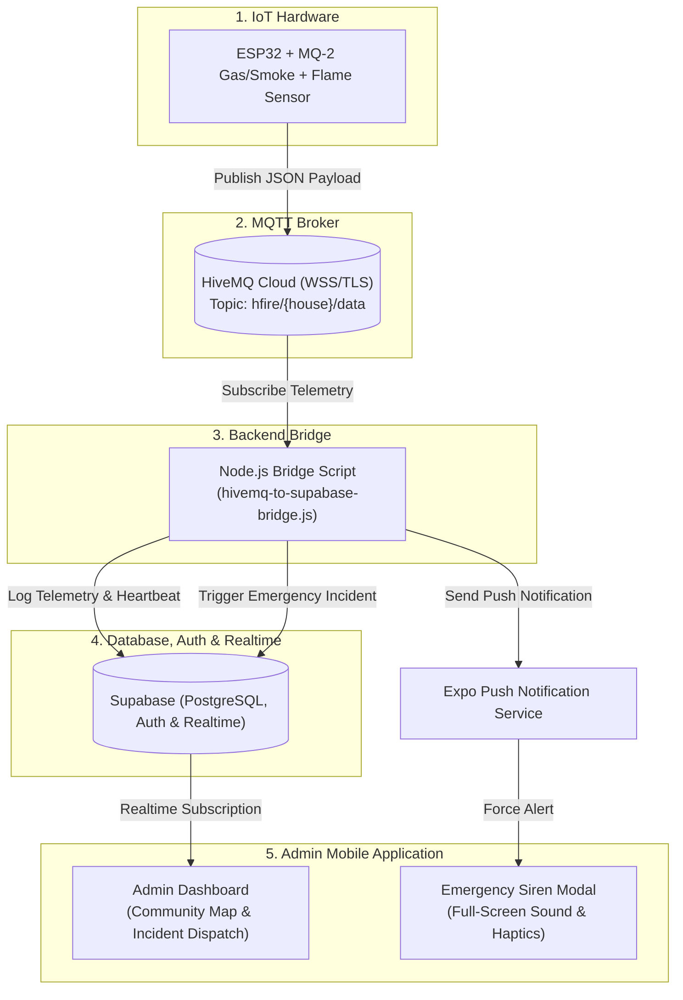

# 📑 H-Fire Admin: Complete System Blueprint & Rebuild Guide (Supabase Only)

This document contains the complete specification, architecture, database schema, hardware code, bridge script, and step-by-step instructions required to build the **H-Fire Admin Monitoring Platform** from scratch using **Supabase** exclusively for Database, Authentication, and Realtime.

---

## 1. System Overview & Roles

**H-Fire Admin** is a centralized real-time IoT fire and gas monitoring system designed for residential communities, subdivisions, or building management.

### User Roles (Admin Only)
* **Admin / HOA / Guard (Monitoring Center)**:
  - Authenticates securely via **Supabase Auth** (Email/Password or Magic Link).
  - Monitors all deployed IoT devices across the community.
  - Views a live interactive map displaying color-coded household safety statuses.
  - Receives community-wide force siren alerts for active incidents.
  - Resolves incidents, dispatches emergency responses, or contacts emergency hotlines (BFP).
  - Manages device registrations and logs.

---

## 2. Architecture & Data Flow



---

## 3. Telemetry Thresholds & Logic

All services reference the exact same threshold logic:

| Status | PPM Level / Condition | Visual Color | Action Triggered |
| :--- | :--- | :--- | :--- |
| **NORMAL** | $\text{PPM} \le 450$ | 🟢 `#4CAF50` (Green) | Baseline environment, safe, log telemetry |
| **WARNING** | $451 - 1500\text{ PPM}$ | 🟠 `#FF9800` (Orange) | Gas/smoke warning banner & push alert |
| **DANGER** | $> 1500\text{ PPM}$ or $\text{Flame} == \text{true}$ | 🔴 `#F44336` (Red) | Emergency Siren Modal, continuous alarm, create active incident |

---

## 4. Full Database Schema (Supabase SQL)

Run this complete SQL script in your Supabase SQL Editor:

```sql
-- Enable UUID extension if not already enabled
CREATE EXTENSION IF NOT EXISTS "uuid-ossp";

-- 1. PROFILES TABLE (Syncs with Supabase Auth auth.users)
CREATE TABLE IF NOT EXISTS public.profiles (
  id UUID PRIMARY KEY REFERENCES auth.users(id) ON DELETE CASCADE,
  email TEXT,
  name TEXT NOT NULL,
  role TEXT NOT NULL DEFAULT 'admin' CHECK (role IN ('admin', 'hoa', 'guard')),
  push_token TEXT,
  updated_at TIMESTAMPTZ DEFAULT NOW()
);

-- Automatic profile creation on user signup
CREATE OR REPLACE FUNCTION public.handle_new_user()
RETURNS trigger AS $$
BEGIN
  INSERT INTO public.profiles (id, email, name, role)
  VALUES (
    new.id,
    new.email,
    COALESCE(new.raw_user_meta_data->>'name', split_part(new.email, '@', 1)),
    COALESCE(new.raw_user_meta_data->>'role', 'admin')
  )
  ON CONFLICT (id) DO UPDATE
  SET 
    email = EXCLUDED.email,
    name = COALESCE(EXCLUDED.name, public.profiles.name),
    updated_at = NOW();
  RETURN new;
END;
$$ LANGUAGE plpgsql SECURITY DEFINER;

DROP TRIGGER IF EXISTS on_auth_user_created ON auth.users;
CREATE TRIGGER on_auth_user_created
  AFTER INSERT ON auth.users
  FOR EACH ROW EXECUTE FUNCTION public.handle_new_user();

-- 2. DEVICES TABLE (Maps Hardware MAC Addresses)
CREATE TABLE IF NOT EXISTS public.devices (
  mac TEXT PRIMARY KEY, -- e.g., 'AA:BB:CC:DD:EE:FF'
  house_name TEXT NOT NULL,
  label TEXT NOT NULL, -- e.g. 'Kitchen MQ2 Sensor'
  block_lot TEXT,
  latitude DOUBLE PRECISION,
  longitude DOUBLE PRECISION,
  last_seen TIMESTAMPTZ DEFAULT NOW(),
  created_at TIMESTAMPTZ DEFAULT NOW()
);

-- 3. GAS LOGS TABLE (Telemetry History)
CREATE TABLE IF NOT EXISTS public.gas_logs (
  id BIGINT GENERATED ALWAYS AS IDENTITY PRIMARY KEY,
  device_mac TEXT REFERENCES public.devices(mac) ON DELETE CASCADE,
  ppm_level INTEGER NOT NULL,
  status TEXT NOT NULL CHECK (status IN ('Normal', 'Warning', 'Danger')),
  created_at TIMESTAMPTZ DEFAULT NOW()
);

-- 4. INCIDENTS TABLE (Active Emergency Triggers)
CREATE TABLE IF NOT EXISTS public.incidents (
  id BIGINT GENERATED ALWAYS AS IDENTITY PRIMARY KEY,
  device_mac TEXT NOT NULL REFERENCES public.devices(mac) ON DELETE CASCADE,
  status TEXT NOT NULL DEFAULT 'Active' CHECK (status IN ('Active', 'Resolved')),
  ppm_at_trigger INTEGER,
  alert_type TEXT, -- 'FIRE', 'GAS / SMOKE LEAK'
  notes TEXT,
  resolved_by UUID REFERENCES public.profiles(id) ON DELETE SET NULL,
  start_time TIMESTAMPTZ DEFAULT NOW(),
  end_time TIMESTAMPTZ
);

-- 5. APP SETTINGS
CREATE TABLE IF NOT EXISTS public.app_settings (
  key TEXT PRIMARY KEY,
  value TEXT NOT NULL,
  updated_at TIMESTAMPTZ DEFAULT NOW()
);

INSERT INTO public.app_settings (key, value) VALUES
  ('bridge_heartbeat', NOW()::text)
ON CONFLICT (key) DO NOTHING;

-- 6. ENABLE ROW LEVEL SECURITY (RLS)
ALTER TABLE public.profiles ENABLE ROW LEVEL SECURITY;
ALTER TABLE public.devices ENABLE ROW LEVEL SECURITY;
ALTER TABLE public.gas_logs ENABLE ROW LEVEL SECURITY;
ALTER TABLE public.incidents ENABLE ROW LEVEL SECURITY;
ALTER TABLE public.app_settings ENABLE ROW LEVEL SECURITY;

-- Allow authenticated users with admin/hoa/guard roles full read/write access
CREATE POLICY "Allow authenticated read on profiles" ON public.profiles FOR SELECT TO authenticated USING (true);
CREATE POLICY "Allow users to update their own profile" ON public.profiles FOR UPDATE TO authenticated USING (auth.uid() = id);

CREATE POLICY "Allow authenticated access to devices" ON public.devices FOR ALL TO authenticated USING (true);
CREATE POLICY "Allow authenticated access to gas_logs" ON public.gas_logs FOR ALL TO authenticated USING (true);
CREATE POLICY "Allow authenticated access to incidents" ON public.incidents FOR ALL TO authenticated USING (true);
CREATE POLICY "Allow authenticated access to app_settings" ON public.app_settings FOR ALL TO authenticated USING (true);

-- 7. ENABLE REALTIME PUBLICATION
ALTER PUBLICATION supabase_realtime ADD TABLE public.gas_logs;
ALTER PUBLICATION supabase_realtime ADD TABLE public.incidents;
ALTER PUBLICATION supabase_realtime ADD TABLE public.devices;
```

---

## 5. Node.js Backend Bridge (`hivemq-to-supabase-bridge.js`)

The backend bridge listens to incoming MQTT telemetry from ESP32 units, writes gas logs to Supabase, triggers incident alarms, and broadcasts Expo Push Notifications directly to all registered admins/guards.

```javascript
const mqtt = require('mqtt');
const { createClient } = require('@supabase/supabase-js');
const dotenv = require('dotenv');
const http = require('http');

dotenv.config();

const supabaseUrl = process.env.EXPO_PUBLIC_SUPABASE_URL;
const supabaseKey = process.env.SUPABASE_SERVICE_ROLE_KEY || process.env.EXPO_PUBLIC_SUPABASE_ANON_KEY;
const supabase = createClient(supabaseUrl, supabaseKey);

const HIVEMQ_URL = `wss://${process.env.EXPO_PUBLIC_HIVEMQ_BROKER}:${process.env.EXPO_PUBLIC_HIVEMQ_PORT}/mqtt`;
const TOPIC_WILDCARD = 'hfire/#';

// Heartbeat updater
setInterval(async () => {
  await supabase.from('app_settings').upsert({ 
    key: 'bridge_heartbeat', 
    value: new Date().toISOString(),
    updated_at: new Date().toISOString() 
  });
}, 30000);

async function sendPushNotification(houseName, alertType, ppm) {
  try {
    // Broadcast to all admins, guards, and HOAs
    const { data: profiles } = await supabase
      .from('profiles')
      .select('push_token')
      .in('role', ['admin', 'hoa', 'guard']);

    if (!profiles || profiles.length === 0) return;

    const messages = [];
    const seenTokens = new Set();

    profiles.forEach(profile => {
      if (profile.push_token && !seenTokens.has(profile.push_token)) {
        seenTokens.add(profile.push_token);
        messages.push({
          to: profile.push_token,
          sound: 'default',
          title: `🚨 EMERGENCY: ${alertType} DETECTED`,
          body: `${houseName}: Critical level detected (${ppm} PPM)!`,
          data: { houseName, alertType, ppm, type: 'emergency' },
          priority: 'high',
          channelId: 'emergency-alerts'
        });
      }
    });

    if (messages.length > 0) {
      await fetch('https://exp.host/--/api/v2/push/send', {
        method: 'POST',
        headers: { 'Content-Type': 'application/json' },
        body: JSON.stringify(messages)
      });
    }
  } catch (err) {
    console.error('Push Notification Error:', err.message);
  }
}

const client = mqtt.connect(HIVEMQ_URL, {
  username: process.env.EXPO_PUBLIC_HIVEMQ_USERNAME,
  password: process.env.EXPO_PUBLIC_HIVEMQ_PASSWORD,
  clientId: `hfire_admin_bridge_${Math.random().toString(16).slice(2, 10)}`
});

client.on('connect', () => {
  console.log('✅ Admin Bridge connected to HiveMQ');
  client.subscribe([TOPIC_WILDCARD]);
});

client.on('message', async (topic, payload) => {
  try {
    const data = JSON.parse(payload.toString());
    if (!data.mac || data.ppm === undefined) return;
    const mac = data.mac.toUpperCase();
    const ppm = Number(data.ppm);
    const flame = data.flame === true;

    // Update last_seen
    await supabase.from('devices').upsert({ mac, last_seen: new Date().toISOString() }, { onConflict: 'mac' });

    let status = 'Normal';
    let alertType = 'NONE';
    if (ppm > 1500 || (flame && ppm > 450)) {
      status = 'Danger';
      alertType = 'FIRE';
    } else if (ppm > 450) {
      status = 'Warning';
      alertType = 'GAS / SMOKE LEAK';
    }

    await supabase.from('gas_logs').insert([{ device_mac: mac, ppm_level: ppm, status }]);

    if (status === 'Danger') {
      const { data: existingIncident } = await supabase
        .from('incidents')
        .select('id')
        .eq('device_mac', mac)
        .eq('status', 'Active')
        .maybeSingle();

      if (existingIncident) {
        await supabase.from('incidents').update({ ppm_at_trigger: ppm, alert_type: alertType, start_time: new Date().toISOString() }).eq('id', existingIncident.id);
      } else {
        await supabase.from('incidents').insert([{ device_mac: mac, status: 'Active', ppm_at_trigger: ppm, alert_type: alertType }]);
      }

      const { data: device } = await supabase.from('devices').select('house_name').eq('mac', mac).single();
      await sendPushNotification(device?.house_name || 'Unknown Location', alertType, ppm);
    }
  } catch (e) {
    console.error('Payload parse error:', e.message);
  }
});

const PORT = process.env.PORT || 8080;
http.createServer((req, res) => {
  res.writeHead(200, { 'Content-Type': 'application/json' });
  res.end(JSON.stringify({ status: 'admin-bridge-active', timestamp: new Date().toISOString() }));
}).listen(PORT);
```

---

## 6. App File & Folder Directory Structure (Admin Optimized)

```plaintext
my-hfire-admin-app/
├── app/                        # Expo Router Pages
│   ├── (auth)/                 # Supabase Authentication Flow
│   │   ├── login.tsx           # Admin Email/Password Login Screen
│   │   └── forgot-password.tsx # Password Reset Screen
│   ├── (tabs)/                 # Main Admin Navigation Tabs
│   │   ├── _layout.tsx         # Tab Bar Configuration
│   │   ├── index.tsx           # Dashboard (All Devices Grid & Status Overview)
│   │   ├── map.tsx             # Interactive Community Map
│   │   ├── incidents.tsx       # Incident Logs & Dispatch History
│   │   └── settings.tsx        # Admin Profile, Push Notifications & App Info
│   ├── _layout.tsx             # Root Layout (Supabase Auth & Admin Context Providers)
│   └── +not-found.tsx          # 404 Fallback
├── components/                 # Reusable UI Components
│   ├── EmergencyModal.tsx      # High-Priority Siren Alert (expo-av & expo-haptics)
│   ├── DeviceCard.tsx          # Card displaying specific device telemetry
│   ├── CommunityMap.tsx        # React-Native-Maps Wrapper
│   └── ErrorBoundary.tsx       # Exception Protection Wrapper
├── context/                    # React Context Providers
│   ├── AuthContext.tsx         # Supabase Auth Session & Role State
│   └── AdminContext.tsx        # Global Alerts & Realtime Incident Stream for Admins
├── constants/
│   ├── thresholds.ts           # Gas & Fire Level Definitions
│   └── theme.ts                # App Colors & Visual Styling Tokens
├── utils/
│   ├── supabase.ts             # Supabase Client Initialization with AsyncStorage
│   └── hivemq-bridge.js        # Node.js Telemetry Bridge Script
├── app.config.js               # Expo SDK Config
├── package.json
└── tsconfig.json
```

---

## 7. Supabase Client Configuration (`utils/supabase.ts`)

```typescript
import 'react-native-url-polyfill/auto';
import AsyncStorage from '@react-native-async-storage/async-storage';
import { createClient } from '@supabase/supabase-js';

const supabaseUrl = process.env.EXPO_PUBLIC_SUPABASE_URL || '';
const supabaseAnonKey = process.env.EXPO_PUBLIC_SUPABASE_ANON_KEY || '';

export const supabase = createClient(supabaseUrl, supabaseAnonKey, {
  auth: {
    storage: AsyncStorage,
    autoRefreshToken: true,
    persistSession: true,
    detectSessionInUrl: false,
  },
});
```